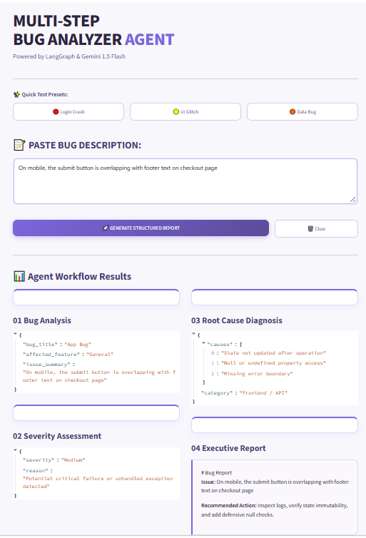

# 🐛 4-STEP BUG ANALYZER AGENT

> An intelligent, multi-step bug report generator powered by LangGraph, Google Gemini 1.5 Flash, and Streamlit.


---

## 📱 App Preview

<p align="center">
  
</p>


---

### 🚀 Live Demo
* **Live App Link:** `Coming Soon (Deploying on Streamlit Cloud)`


---

### 🧠 Architecture & 4-Step Workflow
The agent processes raw user descriptions sequentially across 4 robust LangGraph nodes:

User Input ➔ **[01 Analysis]** ➔ **[02 Severity]** ➔ **[03 Root Cause]** ➔ **[04 Executive Report]** ➔ **UI Display**

| Node | Function Name | Core Output |
| :--- | :--- | :--- |
| **01. Analysis** | `bug_analysis_node()` | `bug_title`, `affected_feature`, `issue_summary` |
| **02. Severity** | `severity_detection_node()` | `severity` level (High/Medium/Low), `reason` |
| **03. Root Cause** | `root_cause_node()` | `causes[]`, `category` |
| **04. Final Report** | `format_report_node()` | Clean Executive Markdown Report |

---

### ✨ Key Features
* **Multi-Step LangGraph Pipeline:** Automated stateful execution across 4 distinct processing stages.
* **Resilient Multi-Key Rotation:** Built-in `itertools.cycle` rotation supporting up to 3 Gemini API keys to bypass rate limits (`RPM`/`TPM`) on free-tier usage.
* **Modern Lavender UI:** Sleek white and soft lilac/purple styling featuring custom cards, hover effects, and a responsive layout.
* **Quick Test Presets:** Pre-configured buttons for instant testing (Login Crash, UI Glitch, Data Bug).
* **Robust Error Handling & Fallbacks:** Graceful dynamic fallbacks ensure the app never leaves the user hanging if an API call fails.

---

### ⚙️ Local Setup & Installation

1. **Clone the repository:**
   ```bash
   git clone https://github.com/MaryamArif85/ai-bug-report-analyzer
   cd your-repo-name

   Install dependencies:
 

    pip install -r requirements.txt  
    
    Configure environment variables:
     GOOGLE_API_KEY_1=your_api_key_1_here
     GOOGLE_API_KEY_2=your_api_key_2_here
     GOOGLE_API_KEY_3=your_api_key_3_here
     
     Run the application locally:
       
     streamlit run app.py
     
      


